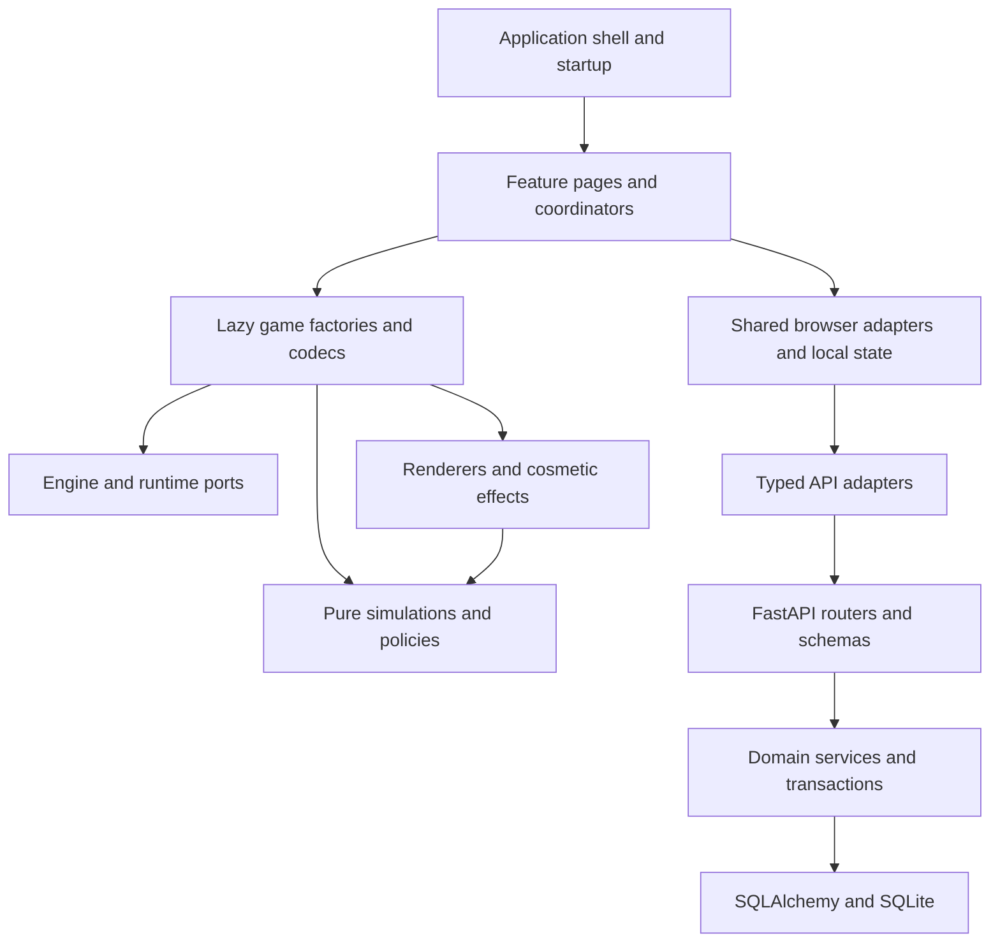

# Arcade Nexus - Developer Documentation

> Architecture, implementation contracts, verification, and maintenance guidance.

**Version:** 0.5.2 | **Last Updated:** 2026-10-20
**Scope:** Local console development. All developer documentation belongs in this file; `docs/` contains only the public static website.

---

## Table of Contents

- [Architecture Overview](#architecture-overview)
- [Technology Stack](#technology-stack)
- [Project Structure](#project-structure)
- [Setup and Runtime](#setup-and-runtime)
- [Feature Ownership](#feature-ownership)
- [Game Integration](#game-integration)
- [Data and API Contracts](#data-and-api-contracts)
- [Database and Recovery](#database-and-recovery)
- [Configuration](#configuration)
- [UI and Accessibility](#ui-and-accessibility)
- [Testing and Verification](#testing-and-verification)
- [Performance and Hardware Acceptance](#performance-and-hardware-acceptance)
- [Website](#website)
- [Versioning and Maintenance](#versioning-and-maintenance)
- [Troubleshooting](#troubleshooting)
- [Current Verification](#current-verification---2026-10-20)
- [Historical Verification](#historical-verification)

---

## Architecture Overview

Arcade Nexus is one React frontend and one FastAPI backend. Feature modules own presentation and session coordination; shared adapters own browser persistence, preferences, input, and networking. The SDK receives typed input, audio, effect, and measurement ports. Pure simulations and codecs do not depend on React, browser storage, or rendering resources.



| Decision | Reason |
| --- | --- |
| Feature-owned frontend folders | A feature's UI, hooks, styles, and tests are maintained together. |
| Narrow cross-feature entry points | Sibling features use explicit `public.ts` exports instead of internal implementation paths. |
| Shared browser adapters | Preferences, controller input, recovery, and result delivery have one reusable owner. |
| Pure game state | Deterministic simulation and save validation can run without a DOM or WebGL. |
| Lazy games and routes | The shell does not eagerly initialize all game renderers. |
| Atomic completion receipts | Retries cannot count the same result, playtime, or awards twice. |
| One local origin | Production frontend and API share a loopback server and stable browser storage origin. |

## Technology Stack

| Area | Technology |
| --- | --- |
| Frontend | TypeScript, React 19, React Router, Zustand, Zod |
| Rendering | Canvas 2D and Three.js/WebGL |
| Frontend tooling | Node.js 24, npm, Vite, ESLint, Vitest, Playwright |
| Backend | Python 3.12, FastAPI, Pydantic, SQLAlchemy asyncio |
| Persistence | SQLite, aiosqlite, Alembic; browser storage for preferences and pending data |
| Backend tooling | uv, Ruff, pytest |
| Website | Buildless HTML, CSS, JavaScript, and bundled assets |

Runtime dependencies are locked in `frontend/package-lock.json` and `backend/uv.lock`. Use `.nvmrc` and `.python-version` as the toolchain references. Hosted CI/CD and binary distribution are outside this repository's current workflow.

## Project Structure

```text
arcade-nexus/
  backend/
    app/
      models/              Database entities
      routers/             HTTP input, responses, and error adaptation
      schemas/             Wire validation and OpenAPI contracts
      services/            Session, history, and backup transactions
      config.py            Runtime settings
      database.py          Connection and migration ownership
      version.py           Shared application version reader
    migrations/            Ordered schema changes
    tests/                 Isolated backend regression tests
  frontend/
    src/
      app/                 Startup, routes, shell, and root recovery
      features/
        backups/           Backup previews, import/export, snapshot UI
        catalog/           Games, favorites, and game browsing
        home/              Continue, recent games, daily challenge
        profiles/          Player setup, selection, and profile page
        progress/          Records, awards, and filtered history
        session/           Launch, runtime coordination, pause, results, slots
        settings/          Preferences, remapping, and data management
      shared/              Browser adapters, reusable UI, and local state
      api/                 Transport, generated-derived types, domain clients
      contracts/           Shared numeric, save, and generated wire contracts
      games/               Game-owned simulation, codec, rendering, and assets
      sdk/                 Engine and reusable runtime capabilities
      test/                Shared test setup
    e2e/                   Real-server browser journeys and shared fixtures
    public/                Bundled runtime artwork, models, and textures
    scripts/               Frontend ownership checks and diagnostics
  contracts/               Cross-language gameplay limits
  docs/                    Static public website only
  scripts/                 Local checks, version synchronization, contract generation
  arcade.py                Source launcher
  catalog.json             Shared game and mode definitions
  version.json             Application version and integer code
  DEVELOPMENT.md           This developer reference
  README.md                User introduction and quick start
  CHANGELOG.md              Version history, including preserved legacy entries
  TASKS.md                 Unfinished work and acceptance criteria
  PRIVACY.md               Data storage and network behavior
  LICENSE.md               License terms
```

Tests live beside their owning frontend feature or library in `__tests__` folders. Shared test infrastructure stays under `src/test`; browser fixtures stay under `e2e`.

## Setup and Runtime

From the root, `python arcade.py --setup` installs locked dependencies, builds the frontend, starts the backend, and opens `http://127.0.0.1:8000`. Later launches use `python arcade.py`. The launcher checks the fixed port rather than silently changing the browser-storage origin. Keep its terminal open and stop it with Ctrl+C.

For development, run `python arcade.py --dev`. Vite serves `http://127.0.0.1:5173` and proxies API calls to the backend. Production and development origins have separate browser storage; export data before switching origins or browsers. Use `--no-browser` to suppress automatic opening.

Startup creates the application-owned engine, migrates the database, synchronizes the catalog, and starts backup scheduling. Shutdown cancels owned background work and closes resources. CLI migration and seed entry points create their own engine instead of relying on an imported process-global connection.

## Feature Ownership

- `app` owns composition, routing, root error recovery, and shell navigation. Application wiring may consume feature modules.
- A feature owns its page, coordinating hooks, components, and styles. Calls into sibling features use a narrow `public.ts` entry point.
- `shared` owns reusable browser capabilities and must not import feature or application modules.
- `sdk` receives preferences, measurement, audio, and game-effect behavior through typed ports. It must not import application state or HTTP clients.
- Pure simulation, policy, and codec modules avoid browser globals, preference stores, UI, and renderers.
- Session panels receive display data and named commands. They do not call persistence APIs or mutate the engine directly.
- Backend services own transaction and domain behavior. HTTP routers adapt requests, validated responses, and domain errors; services never import routers.

`frontend/scripts/check-boundaries.mjs` parses static imports, re-exports, type imports, and lazy imports, checks ownership rules, and rejects local import cycles. `scripts/boundaries.py` checks backend, SDK, session-panel, and benchmark boundaries. These checks run locally through `scripts/check.py`.

Use focused names and real responsibility boundaries. File length can identify a review target; splitting a cohesive simulation or creating unnecessary forwarding layers is not a substitute for improving ownership.

## Game Integration

`catalog.json` owns bundled modes, rule versions, score units, ranking policies, supported difficulties, and default tuning. Backend seed and pure frontend catalog metadata consume it. Descriptors attach lazy factories, lazy codecs, and control-guide metadata.

When adding or changing a game:

1. Define its catalog identity, modes, ranking, tuning, and rules version.
2. Keep durable simulation and random-generator state independent of rendering. Inject cosmetic effects through the existing effect interfaces.
3. Implement the SDK game adapter, renderer, pause/resume, result reporting, and complete resource disposal.
4. Add a pure codec that validates saved state and owns historical migrations. Restore preflight must finish before replacing the live engine.
5. Register lazy factories/codecs and provide a launch guide, keyboard/controller controls, and bundled artwork.
6. Verify deterministic restoration, relevant mode rules, result qualification, and the browser launch/save/recovery journey.

The engine uses a fixed 60 Hz simulation and bounded frame work. Input presses are consumed once per simulation step; axes retain analog magnitude. Rendering is capped without reducing Full HD drawing-buffer quality. Paused games stop periodic simulation/render work while retaining immediate pause/exit checkpoints.

Snake, Raptor, Breakout, 2048, Tetris, and Asteroids separate their pure simulation from rendering. Prism retains its simulation/renderer split. Flight's `SpaceJourney` owns durable progress and coordinates movement, collisions, race progression, and rewards. Scene factories, sky construction, resource disposal, HUD, and audio have distinct owners.

Flight streams nearby sectors and preserves its universe seed, route RNG, race, visited sectors, XP, ship, boost/shield state, and steering state. Collisions retain exploration progress. Three.js resources must be released on normal teardown and late asynchronous model loading; shared lighting textures require the existing public-hook cleanup.

2048 explicitly completes at tile 1,048,576 under rules version 4. Classic undo remains available at the ceiling. Daily puzzle boards have a move limit and do not spawn new tiles. The semantic board reader reflects the same live board and queues commands through the update loop.

Tetris Sprint uses time ranking from rules version 2. Compare results within game, mode, difficulty, and rules version. Seeded randomness must be included in saves so Continue preserves future pieces, obstacles, and authored sequences.

## Data and API Contracts

The running server's `/docs` and `/openapi.json` describe the authoritative wire schemas. Generate TypeScript schema types offline:

```bash
uv run --project backend python scripts/contracts.py
uv run --project backend python scripts/contracts.py --check
```

Generated schema types live in `frontend/src/contracts/api.generated.ts`; domain adapters normalize wire details. Do not hand-edit generated types. `contracts/gameplay-limits.json` supplies browser/Pydantic numeric bounds. Invalid saved scores are rejected before replacing a run; unsupported arithmetic stops visibly rather than persisting invalid progress.

Local player requests carry `X-Profile-ID`. Activation is per browser tab, and profiles are selectors for a trusted household, not Internet authentication. Mutations invalidate older profile-list responses so delayed responses cannot undo a newer selection. Lists and activation keep their own request-generation ownership.

`POST /api/stats/{slug}/start` reserves a session UUID. Local play may continue through a temporary backend outage. `POST /api/progress/{slug}/complete` atomically commits the immutable result, playtime, qualified awards, and mode record. An identical retry replays the stored receipt; a conflicting reuse of the UUID is rejected.

The completion queue persists before delivery, retries temporary failures with bounded backoff, and retains permanent failures for explicit retry/export. Cross-tab reconciliation and a retry lock prevent independent tabs from replacing newer retry state. Queue metadata is separate from the HTTP payload.

Terminal results delete only matching recovery in the same transaction. Continuing a save starts a new session and does not reopen an already completed UUID or count earlier playtime twice. Results, recovery, and outstanding reservations have shared identity mappings during backup restore.

History filters and sorting apply before pagination and return the real matching total. Date filters are timezone-aware with an exclusive end bound. Household records compare compatible modes/difficulties/rules. Achievement summaries use bounded aggregate queries instead of reading all award rows.

## Database and Recovery

SQLite uses foreign keys, WAL, a ten-second busy timeout, and application-owned connections. File databases use normal pooling; shared in-memory databases use `StaticPool`. Lock failures that outlast the wait return 503 with `Retry-After: 1`.

Default data lives in the platform's ArcadeNexus user-data directory. An existing `backend/arcade_nexus.db` takes precedence for compatibility. `DATA_DIR` chooses the default storage directory; `DATABASE_URL` explicitly selects a SQLite file. Relative paths and `.env` resolve against `backend`, independent of launch working directory.

Startup runs Alembic migrations before catalog synchronization. The baseline adopts only a complete compatible legacy schema. Pre-upgrade backups use SQLite's backup API, include committed WAL contents, and never overwrite earlier attempts. Failed schema upgrades roll back. Manual migration commands run from the repository root:

```bash
uv run --directory backend python -m app.migrate
uv run --directory backend alembic history
uv run --directory backend python -m app.seed
```

Recovery is separate from five manual slots. Snapshots occur every five seconds and on pause/exit. Writes serialize per player/game, coalesce queued snapshots, preserve newer run identity, and keep deletes ordered. Save envelope format 2 contains game, mode, rules version, difficulty, configuration, RNG-containing state, score, timestamp, and originating session UUID. Format 1 receives compatibility defaults. Game codecs validate framing and state before the current run is replaced.

Export takes a consistent database snapshot in a fixed nine SELECT queries and includes retired-game history. Browser export adds live preferences, pending results, and recoveries, including in-memory fallbacks after storage failures. Import adds player copies and preserves existing players; preview uses the same semantic validation without writing. The portable JSON limit is 20 MiB.

Automatic server backups default to seven snapshots. A due snapshot is taken at startup; hourly checks enforce the 24-hour interval while the server runs. Empty installations are skipped. Server snapshots include server-saved data; a browser export is still needed for browser-only preferences and pending data.

Before replacing a database file, stop every backend process and preserve the current database together with its WAL/SHM files. Do not delete sidecar files while the database is active. `.gitignore` excludes local databases and their sidecars.

## Configuration

| Setting | Purpose |
| --- | --- |
| `HOST`, `PORT` | Launcher address, default loopback and port 8000. |
| `DATA_DIR`, `DATABASE_URL` | Persistent storage directory or explicit SQLite URL. |
| `FRONTEND_DIR` | Optional built frontend directory served by FastAPI. |
| `DEBUG` | Development detail; false by default. |
| `ALLOWED_HOSTS`, `CORS_ORIGINS` | Local request and browser-origin protections. |
| `AUTO_BACKUP_ENABLED` | Enable rotating server snapshots. |
| `BACKUP_RETENTION`, `BACKUP_INTERVAL_HOURS` | Snapshot count and interval. |
| `ARCADE_BACKEND_URL` | Vite's local proxy destination. |
| `CHROMIUM_PATH` | Optional browser executable for local diagnostics. |

Use `backend/.env.example` and `backend/app/config.py` for accepted formats and validation. Keep `.env`, databases, credentials, and generated local reports out of Git. Shared browser-visible version metadata comes from `version.json`; avoid environment overrides when checking version alignment.

## UI and Accessibility

Theme tokens, shell chrome, common controls, and feature styles have explicit owners. The existing console stylesheet retains its original cascade order during the ownership migration. Game HUD/briefing CSS stays lazy and scoped. Preserve keyboard focus, high contrast, reduced motion, and Full HD rendering when changing styles.

Menu focus shares hidden, inert, disabled, and closed-disclosure handling. Modal ownership must prevent background controls from consuming controller actions. Escape/P and controller Start pause; loss of focus or controller disconnect pauses a run. Settings validates custom bindings against other bindings, aliases, and reserved shortcuts.

Browser preference failures preserve live values and offer export instead of silently reverting to stale storage. Root recovery offers backup export before reload. Shared network checks suspend while hidden; controller polling sleeps while idle. Shared audio avoids unused contexts, suspends when silent, and survives blocked browser audio initialization.

## Testing and Verification

From the root:

```bash
python scripts/check.py
python scripts/check.py --browser
```

The first command checks version alignment, generated contracts, ownership, Ruff, pytest, ESLint, Vitest, TypeScript, and the production build. `--browser` adds real-server Playwright journeys. Browser tests use one worker, isolated servers, and a temporary database. Never point browser tests at personal data.

Focused commands:

```bash
uv run --project backend pytest -q backend/tests/test_progress.py
uv run --directory backend ruff check . ../scripts ../arcade.py
node frontend/scripts/check-boundaries.mjs
cd frontend
npm run test:unit -- src/features/session/__tests__/sessionLifecycle.test.tsx
npm run test:e2e -- sessions.spec.ts
npm run build
```

Playwright needs a browser installed once with `npx playwright install chromium` from `frontend`. Node-only simulations run separately from JSDOM UI/adapters. Existing tests cover deterministic saved futures, immutable/concurrent receipts, transactional restore, profile ownership, storage failures, focus, controller handover, pause/restart/quit, numeric limits, Full HD buffers, and 3D resource disposal.

Run affected checks while iterating, then the full local gate before a release milestone. Run resource-heavy commands serially. Tests should cover behavior and failure boundaries rather than duplicate implementation details. Hosted CI/CD is outside scope.

## Performance and Hardware Acceptance

Settings records bounded local measurements for initialization, average FPS, frame-interval p50/p95, drawing-buffer dimensions, and graphics profile. Export samples when comparing devices. Measurement storage is local, bounded, validated, and not telemetry.

For a visible Full HD laptop diagnostic:

```bash
python scripts/laptop_check.py --power ac
python scripts/laptop_check.py --power battery --browser msedge
```

`--all-modes` expands coverage. The default visits all eight games, adds late-run 3D cases, samples 60 seconds per case, and measures repeated entry/exit. Keep the diagnostic visible and close competing heavy applications. It uses isolated game instances rather than player progress. Review actual renderer identity, frame pacing, resource trends, power, and responsiveness together.

Software-rendered or short headless runs verify runner behavior and regression conditions, not native GPU performance or power consumption. Keep these human/device acceptance items open until the specified evidence exists:

| ID | Required evidence |
| --- | --- |
| H1 | Named integrated/dedicated GPU, Full HD frame pacing, sustained memory/resource trends, AC/battery power and thermals, physical input latency. |
| H2 | Wired/Bluetooth controllers on target OS/browser combinations, reconnect behavior, and controller-only onboarding. |
| H3 | Real browser zoom/OS magnification and assistive-technology use, including 2048's board reader and controls. |
| H4 | Unfamiliar-player sessions across all eight games, mode completion, difficulty fairness, controls clarity, and voluntary replay. |

Record device/browser/build, steps, observations, and failures alongside each acceptance result. Automated checks cannot substitute for these observations.

## Website

`docs/` contains only the static public website: HTML, CSS, JavaScript, local fonts, and artwork. It has no build step or server API. Preview from the root with `python -m http.server 8080 --directory docs`, then open `http://127.0.0.1:8080`.

The website explains the console, its games, source setup, controls, and data ownership. Source and support links point to GitHub. There is no binary download flow. Hosting configuration and automated deployment are intentionally absent; publishing is a separate user action.

Keep developer documentation here, product introduction in README, user-facing changes in CHANGELOG, unfinished work in TASKS, and data handling in PRIVACY. Do not add a second development guide or place review reports under the website directory. Local diagnostic output belongs in ignored `.artifacts/` or a user-chosen external path.

## Versioning and Maintenance

`version.json` is authoritative. Every component of `x.y.z` is a single digit: `0.0.9` advances to `0.1.0`; `0.9.9` advances to `1.0.0`. This project uses that explicit sequential milestone scheme. The integer code is the version with dots removed, interpreted as an integer.

```bash
python scripts/version.py --set 0.0.1
python scripts/version.py --check
```

The synchronization script updates frontend manifest/lock metadata, backend project/lock metadata, and document version headers. The backend reads the shared metadata at runtime. Dependency versions are unaffected. Each milestone is one commit with `vX.Y.Z: Title Case Summary`; change versions only when requested.

Keep changelog entries concise, user-facing, and limited to verified completed behavior. Preserve historical entries. Keep the backlog limited to unfinished work, using stable IDs and explicit location/current/change/acceptance fields. Document concrete exceptions and known limits without marking unperformed hardware checks complete.

Before rebuilding history, preserve both branch tips and all refs in a recoverable bundle. Verify the resulting tree against the prepared source, inspect each commit's scope, and verify versions and dates. Reconstructed commit timestamps are scheduling metadata; they are not dates on which the retained historical test evidence was produced. Merge/publication is a separate user action.

## Troubleshooting

- **Port occupied:** Stop the existing console or its conflicting process. The launcher keeps a fixed origin rather than switching ports.
- **Different saves in development:** Ports 8000 and 5173 are different browser origins. Export from the origin holding the data before switching.
- **Pending results:** Keep the tab open, reconnect the local server, and use Settings to retry or export. Permanent validation failures remain visible.
- **Preferences do not persist:** Check the storage warning. Live values remain usable and are included in export.
- **Migration rejected:** Preserve the database and pre-upgrade backup. Do not stamp a partial legacy schema as compatible.
- **Database locked:** Close extra writers and retry after the configured timeout. Do not remove active WAL/SHM files.
- **Controller focus is missing:** Check browser focus, controller connection, modal state, and dead-zone/remapping settings.
- **Low 3D FPS:** Record actual GPU/renderer and drawing-buffer size with the laptop diagnostic. A software WebGL result is not native GPU acceptance.

## Current Verification - 2026-10-20

The reorganized source was checked on Windows with locked dependencies. Ruff, ESLint, generated OpenAPI parity, ownership/import-cycle checks, all 225 frontend tests, and the production build passed. The application stylesheet, game rules, shared limits, runtime assets, and dependency declarations were preserved; a source comparison covered 262 paths with only the declared import/ownership and version changes.

The real-server browser run passed 47 of 48 cases. The Prism Rush save/resume case timed out with a browser storage-denial error and then passed on a focused retry without a gameplay fix. All 48 cases were therefore exercised successfully across that run and retry, including Full HD drawing buffers, controls, recovery, backup flows, and 3D resource collection. The installed headless browser was selected through `CHROMIUM_PATH`; no browser download was needed. Desktop and phone website previews verified filters, command copying, bundled images, and absence of horizontal overflow.

Backend tests reported 110 passes and 11 failures in both the unchanged baseline and the reorganized source. Windows SQLite URL/path handling and the static-server API fallback are tracked in TASKS as BUG-0001 and BUG-0002. Those existing behaviors were deliberately retained during this structural work. Consequently the complete `scripts/check.py` gate does not pass on this Windows baseline; these records do not declare a release ready or close H1-H4.

## Historical Verification

The pre-reset source baseline was commit `004813ff33a4711d71fd42c12d7ea8223c2caa44`. Its review records reported 121 backend tests, 225 frontend tests, and 48 browser cases, alongside ownership, generated-contract, lint, type, build, and software-rendering checks. Those are historical results from the previous tree, not fresh acceptance of a later refactor.

That review closed reproduced software findings R1-R16 and architecture recommendations A1-A8: backup identities/reservations, malformed snapshots, profile races, launcher shutdown, controller/focus routing, audio idling, stale records, atomic recovery deletion, legacy save configuration, numeric bounds, pure codecs, generated contracts, session ownership, simulation/rendering separation, style ownership, and renderer retention.

The former narrative reviews and raw measurement snapshots remain recoverable in the preserved pre-reset history. Their historical counts, source digests, advisory results, and software-renderer measurements must not be presented as current measurements. This file carries the maintained contracts and outstanding H1-H4 acceptance work forward.

---

[Back to README](README.md)
