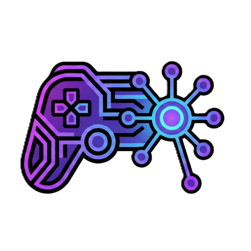

<p align="center">
  
</p>

<h1 align="center">Arcade Nexus</h1>

<p align="center">Your games. Your progress. Your local arcade.</p>

<p align="center">
  
  
  
</p>

## Why Arcade Nexus

Arcade Nexus is a local browser-based console for short desktop play sessions. Eight bundled games share keyboard and controller controls, local player profiles, recovery saves, and household records. Assets and fonts are bundled; normal play works without Internet access after setup.

## Start the console

Install Python 3.12, [uv](https://docs.astral.sh/uv/), and Node.js 24 with npm. From the repository root:

```bash
python arcade.py --setup
```

Setup installs locked dependencies, builds the frontend, starts the local server, and opens **http://127.0.0.1:8000**. Internet access is needed for the initial dependency installation. For subsequent launches:

```bash
python arcade.py
```

Keep the terminal open while playing. Ctrl+C stops the console; `--no-browser` lets you open the address yourself. This project runs from source and does not distribute a desktop executable.

## Features

- **Eight games:** Arcade classics, authored daily challenges, and two 3D experiences.
- **Local players:** Separate profiles, favorites, achievements, and household comparisons.
- **Return to your run:** Recovery snapshots every five seconds and on pause/exit, plus five manual save slots.
- **Reliable results:** Retryable result delivery and records separated by game, mode, difficulty, and rules version.
- **Keyboard and controller:** Remapping, controller dead-zone settings, on-screen text entry, and automatic pause on focus loss or controller disconnect.
- **Keep your data:** JSON backup export/import, restore previews, and rotating server backups.
- **Comfort settings:** Volume, reduced motion, and a text-board option for 2048.

## Games

| Game | What to play |
| --- | --- |
| Neon Snake | Classic, authored mazes, timed Sprint, and Bonus Sprint. |
| Raptor Run | Jump and duck through obstacle phrases across four biomes. |
| Neon Breakout | Three-sector campaigns or six-sector Arcade with pickups and medals. |
| Merge 2048 | Relaxed play with undo, no-undo Challenge, or daily puzzles. |
| Stellar Flight | Explore a procedural universe, race, survey landmarks, and unlock ships. |
| Neon Tetris | Marathon or a time-ranked 40-line Sprint. |
| Asteroids | Wraparound flight, splitting rocks, escalating waves, and three hulls. |
| Prism Rush | A 3D three-lane highway with authored rhythms and collectible crystals. |

## Controls and recovery

Pause with Escape/P or controller Start. Use directional controls and A/B in menus; shoulder buttons change main tabs. Each game's launch menu explains its controls.

Continue restores a saved board as a new session, keeping earlier history separate. A sudden termination can lose progress since the last durable snapshot. Settings shows results that still need to sync.

## Your data

Settings provides backup export, previews, import, and automatic server snapshots. Import creates player copies and keeps existing players. Export from the same browser origin to include its preferences, recovery, and pending results. Keep a tab open if it reports browser storage failures until its data is saved or exported.

The database lives in the platform's ArcadeNexus user-data directory. An existing `backend/arcade_nexus.db` remains supported. Local profiles are for a trusted household; keep the server on loopback. Read [PRIVACY.md](PRIVACY.md) for storage and network details.

## Community and support

- Report bugs or request features through [GitHub Issues](https://github.com/qtremors/arcade-nexus/issues).
- Review completed changes in [CHANGELOG.md](CHANGELOG.md) and unfinished work in [TASKS.md](TASKS.md).

## Credits

Built by [Tremors](https://github.com/qtremors) with [React](https://react.dev/), [Three.js](https://threejs.org/), [FastAPI](https://fastapi.tiangolo.com/), [SQLAlchemy](https://www.sqlalchemy.org/), [SQLite](https://sqlite.org/), [Vite](https://vite.dev/), and the libraries listed in the project manifests. Each dependency remains subject to its own license.

## For developers

Architecture, setup, configuration, game integration, save compatibility, testing, performance checks, and maintenance conventions live in [DEVELOPMENT.md](DEVELOPMENT.md).

## License

Arcade Nexus is source-available under the **Tremors Source License (TSL)**. Attribution is required; commercial use requires written permission. Read [LICENSE.md](LICENSE.md).

---

<p align="center">Made by <a href="https://github.com/qtremors">Tremors</a></p>
