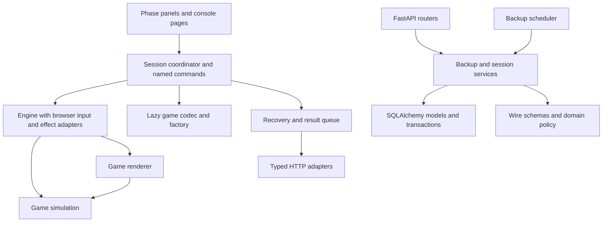

# Architecture and maintainability review

Reviewed on `ag-dev`, 2026-10-14, against the working tree following [the functional review](DEEP_REVIEW.md). This pass changes documentation and measurements only. The refactors below are **recommendations**, not completed code changes.

The React/FastAPI/SQLite design fits this local arcade. The main architectural debt is concentrated session orchestration, weak ownership between layers, and duplicated contracts. **`useGameSession` is the clearest god-function hotspot.** File length also flags game/rendering and stylesheet work, but several large files have a coherent purpose and a lower refactoring priority.

## Measured structure

[Raw measurements](architecture-metrics.json) cover 90 frontend production TypeScript modules, 42 backend application modules, and a size inventory of 194 maintained code/style files. Counts include blank lines/comments; they are physical size measurements, not complexity scores. Eight frontend production files reach 500 lines; no backend application file reaches 500.

The analyzed explicit local-import graph contains no multi-module static runtime cycles in either language. The frontend remains acyclic when local dynamic and type-only imports are included; the backend remains acyclic when function-local imports are included. These are syntactic module graphs, excluding external packages, implicit package initialization, reflective/framework imports and CSS. An acyclic graph can still violate intended layer direction.

| File | Lines | Architectural assessment |
| --- | ---: | --- |
| `frontend/src/hooks/useGameSession.ts` | 647 | Highest-priority ownership problem: a 606-line hook, 16 local static dependencies, 12 `useState`, 13 `useRef`, seven effects and **39 returned members**. |
| `frontend/src/components/GameCanvas.tsx` | 437 | All session phases in one view; directly accesses the engine and performs a save mutation. Closely coupled to the large hook. |
| `backend/app/routers/data.py` | 422 | HTTP endpoints, backup schemas, validation, export queries, import transactions and identity mapping live together. |
| `backend/app/routers/progress.py` | 335 | The 136-line completion endpoint owns multiple domain policies and a database transaction. |
| `frontend/src/games/stellar-flight/SpaceJourney.ts` | 889 | Rendering-independent, but its aggregate has 64 declared fields and a 304-line update combining several systems. |
| `frontend/src/games/snake/Snake.ts` | 808 | Rules, rendering helpers, feedback and snapshot handling share one class. |
| `frontend/src/games/raptor-run/RaptorRun.ts` | 773 | Similar mixed ownership; the main render method alone is 184 lines. |
| `frontend/src/games/stellar-flight/StellarFlight.ts` | 728 | Large, largely cohesive rendering/resource adapter. Lower priority than the session hook and Flight simulation. |
| `frontend/src/games/breakout/Breakout.ts` | 558 | Collision/campaign rules, renderer/cache and snapshot code share one class. |
| `frontend/src/games/merge-2048/Merge2048.ts` | 504 | Rules/undo, rendering, semantic board controls and snapshots share one class. |
| `frontend/src/api/client.ts` | 549 | Central transport, manually maintained types and domain adapters. High fan-in (17 local static consumers), mostly straightforward code; contract ownership matters more than length. |
| `frontend/src/console.css` | 1,925 | Largest stylesheet; shell, catalog, dialogs, game menus, history and responsive overrides share global ownership. |
| `frontend/src/index.css` / Flight CSS | 492 / 558 | Global baseline and game-specific styles overlap with console menu rules. |
| `frontend/e2e/console.spec.ts` | 1,485 | Tests and fixtures for many unrelated journeys; strong behavior coverage, increasingly expensive navigation and fixture maintenance. |
| `frontend/e2e/improvements.spec.ts` | 527 | Another broad journey collection with duplicated profile/session setup. |

`backend/app/seed.py` is 354 lines, partly declarative content. `main.py` is 165 lines and primarily application wiring. Neither is a leading god-file concern. Lengthy JSX or mesh construction also deserves a different judgment from lengthy transaction/lifecycle logic.

## Prioritized findings

“High” below means architectural refactoring priority; it is not a claim of a new critical runtime failure. The previously reproduced numeric-limit defect remains R12 in the functional review.

### A1 — High: session ownership is split across an oversized hook and its view

Evidence: [hook state and responsibilities](../frontend/src/hooks/useGameSession.ts#L42), [public surface](../frontend/src/hooks/useGameSession.ts#L607), and [save deletion inside the view](../frontend/src/components/GameCanvas.tsx#L397).

The hook handles engine creation/cancellation, clocks, session identity, results, recovery, save slots, mode/config migration, records, navigation, keyboard/controller routing, focus and confirmation. It exposes mutable engine/profile refs, phase/state setters and a generic `act` executor. `GameCanvas` uses those internals to implement deletion through `savesApi`; other slot operations live in the hook. A caller can therefore change session state or persistence without going through one command owner. The existing [hook regression](../frontend/src/__tests__/gameSession.test.tsx#L9) requires several module mocks and access to a mutable engine seam.

Recommended boundary: one session coordinator owns the active engine/run identity and the ordering of commands. Extract active-time/completion construction, checkpoint/save operations and menu input into focused modules with explicit inputs. Present a typed read-only view plus named commands (`pause`, `resume`, `deleteSlot`, etc.); keep DOM refs only where binding requires them. Move deletion into that command surface, then split `GameCanvas` into launch, pause, results and slot panels. Keep phase transitions and async generation checks under one owner during extraction. Moving the same 600 lines into a controller class without reducing responsibilities would preserve the problem.

### A2 — High: reusable backend operations are owned by HTTP routers

Evidence: [scheduler imports router-owned schema/export](../backend/app/services/backups.py#L78), [backup schemas](../backend/app/routers/data.py#L36), [export](../backend/app/routers/data.py#L204), [import transaction](../backend/app/routers/data.py#L321), and [cross-router completion helper](../backend/app/routers/progress.py#L25).

`RotatingBackups` has a real non-HTTP use case, yet imports `Backup` and calls the decorated `export_data` function from `routers.data`. `progress` also imports `same_completion` from `routers.stats`. Router dependencies are acting as shared application/domain APIs. Backup schemas and business validation are embedded beside file responses and route handlers, so transport changes and data-policy changes compete in the same module.

Recommended extraction: `schemas/backup.py` for portable formats; `services/backup_transfer.py` for validation/export/import; and shared session policy helpers outside routers. Route handlers adapt HTTP inputs/errors to those operations, and the scheduler calls the same service directly. Move completion orchestration into a session service after the smaller backup extraction. Preserve one transaction for completion, one transaction for import, the consistent export snapshot and its nine-query budget. Keep legacy completion semantics explicit; its score/award behavior differs from the newer atomic endpoint. SQLAlchemy is already a useful persistence abstraction here; extra pass-through repository classes are not required for this extraction.

### A3 — High: contracts have several owners, and a real type mismatch is present

Evidence: [frontend metrics](../frontend/src/sdk/GameSDK.ts#L44), [queue schema](../frontend/src/services/sessionQueue.ts#L24), [backend metrics](../backend/app/schemas/stats.py#L20), [frontend session type](../frontend/src/api/client.ts#L103), and [backend session response](../backend/app/schemas/stats.py#L89).

Metrics are independently described in TypeScript, Zod and Pydantic. Wire response interfaces are maintained manually in the frontend. **`SessionResponse.difficulty` is a required nullable string on the backend, while `GameSession.difficulty?: string` is optional and excludes null in TypeScript.** Current rendering often applies a fallback, but the compiler does not represent the wire contract correctly. Separately, R12 demonstrates that accepted game state can exceed queue/API bounds.

Local OpenAPI inspection found 45 operations: 25 have a nonempty success JSON schema, 17 advertise an empty JSON schema, and three have no success JSON schema/body. The empty-schema count includes the snapshot download plus root/health; the material gaps are completion receipts, records, history, preview and import responses. Those gaps prevent useful automatic response-type generation for central workflows.

Recommended sequence: add explicit response models to those workflows; establish an offline OpenAPI-to-TypeScript generation or parity-check step; derive frontend domain types from a shared frontend contract module rather than copying interfaces. Keep browser queue metadata and HTTP payloads distinct through an adapter. Runtime validation must remain at storage/network boundaries. Align game-result limits with that contract and resolve R12 separately with explicit boundary behavior. Code generation alone cannot choose a 2048 continuation policy or repair an invalid simulation state.

### A4 — Medium/high: save migration and validation are scattered

Evidence: [slug-specific envelope migrations](../frontend/src/services/saves.ts#L16), [descriptor only provides construction](../frontend/src/games/descriptors.ts#L27), [temporary instance used for validation](../frontend/src/hooks/useGameSession.ts#L468), and [Flight hydration/migration](../frontend/src/games/stellar-flight/SpaceJourney.ts#L809).

Shared save code knows particular game names and historical config values. Individual classes separately parse state, apply defaults, migrate versions and rebuild runtime state. Restore preflight constructs and destroys a game to validate its state before preparing another instance; configuration is applied later. This spreads one compatibility decision across envelopes, descriptors and game internals. The recent Raptor configuration repair is a concrete example of that cross-file coupling.

Recommended boundary: each lazily loaded game module exports a pure save codec that validates/migrates its mode, config and snapshot before engine replacement, plus a separate game factory. Infer snapshot types from its schema and keep version steps explicit. The common envelope reader handles identity/version framing; game-specific compatibility stays with its game. Reuse codecs where detailed preview/import validation is needed. Preserve lazy loading: eagerly importing every game codec through the catalog could pull large dependencies into startup. Keep state validation independent of GPU/audio/DOM construction.

### A5 — Medium: large game aggregates combine systems or rules with rendering

Evidence: [Flight update](../frontend/src/games/stellar-flight/SpaceJourney.ts#L448), [route planning](../frontend/src/games/stellar-flight/SpaceJourney.ts#L350), [Snake](../frontend/src/games/snake/Snake.ts#L37), [Raptor renderer](../frontend/src/games/raptor-run/RaptorRun.ts#L321), and the existing [Prism simulation](../frontend/src/games/prism-rush/PrismRun.ts#L35).

Flight already separates simulation from rendering, which is worth preserving. Its simulation still combines input toggles, steering/energy, collisions/exploration, gate/race results, rewards and contracts in one 304-line update. Snake/Raptor/Breakout combine rendering and durable rules in one class. These changes have different reasons to evolve: balance, art, compatibility and graphics resources.

Extract Flight route/race progression and objective/reward policies behind explicit state and an unchanged update order; keep `SpaceJourney` coordinating one durable journey. For a 2D pilot, separate Raptor or Snake's renderer and pure simulation using the existing Prism split as a local pattern. Keep feedback as an adapter receiving bounded events/callbacks. Pass a read-only live rendering view; serializing/cloning the complete save on every frame would add avoidable work. Preserve saved RNG, next-step trajectories, shader/material quality, Full HD caches and disposal ownership. A general ECS, universal physics system or cross-game inheritance hierarchy has no demonstrated benefit here.

### A6 — Medium: SDK code reaches into application stores/services

Evidence: [engine imports measurement persistence and constructs input](../frontend/src/sdk/GameEngine.ts#L1), [input reads Zustand settings](../frontend/src/sdk/InputManager.ts#L1), and [game feedback reads preferences/audio singleton](../frontend/src/games/feedback.ts#L1).

The loop's renderer/input responsibilities are coherent, but its dependencies reach upward into application persistence and the preference store. Importing several game classes also imports browser preference initialization through feedback. This increases the amount of browser/app context required for rule tests and makes benchmark input substitution rely on internals.

Use small typed seams for input, measurement reporting and preference/effect reads, wired once by the application or game adapter. Browser input can remain the default adapter and preferences must still update live. This targets testability and responsibility direction; no new portable SDK package is needed. Keep queued results and shared audio at application lifetime, not inside each game hook, so route/profile remounts retain pending work and do not allocate redundant contexts.

### A7 — Medium: stylesheet ownership depends on a growing global cascade

Evidence: [global import order](../frontend/src/main.tsx#L3), [base overlay/panel](../frontend/src/index.css#L238), [console panel override](../frontend/src/console.css#L825), [another late panel rule](../frontend/src/console.css#L1910), and [Flight overlay override](../frontend/src/games/stellar-flight/flight.css#L19).

`index.css` defines the theme/menu baseline, `console.css` redefines root tokens and shared menu styling, and lazy game CSS adds scoped overrides. Responsive overrides are legitimate, but the same panel's ownership is distributed across distant blocks/files. The 1,925-line console file also contains unrelated feature styles. A visual edit requires understanding both selector scope and load order.

Consolidate theme tokens and shared game-menu styles first. Move catalog/history/settings/dialog styles beside their features using consistently scoped classes or CSS Modules; keep game HUD styles with their game. Record cascade/layer order explicitly, and merge overrides into the owning rules as each feature moves. Preserve accessible focus, native dialogs, reduced motion, narrow layouts and visual acceptance. Avoid combining this with a palette or rendering redesign.

### A8 — Medium: tests and diagnostics depend on broad fixtures and private implementation details

Evidence: [large console suite/shared helpers](../frontend/e2e/console.spec.ts#L1), [duplicate profile setup](../frontend/e2e/improvements.spec.ts#L1), [serial shared servers](../frontend/playwright.config.ts#L3), [benchmark input override](../frontend/scripts/benchmark-games.mjs#L201), and [direct game-state field reads](../frontend/scripts/benchmark-games.mjs#L213).

The browser suite has valuable coverage but many domains share two broad spec files and one temporary server database. Each case creates a player without removing the household; exports/restores include that growing household. The benchmark reads private engine samples/input and game renderer/simulation fields from JavaScript, so a private rename can break diagnostics outside TypeScript checks.

Split journeys by player/catalog, session/recovery, backups/history, gameplay and accessibility with shared typed fixtures. Keep one worker through the initial file split; isolate household-wide data per worker before adding parallelism. Add narrow internal diagnostic/input interfaces for the benchmark and keep declared stress fixtures validated through codecs. These interfaces do not need production UI controls. After pure simulation extraction, run genuinely DOM-free tests in a Node test project while retaining JSDOM for components/browser adapters. The current suite applies JSDOM to every unit file.

## Secondary cleanup and healthy boundaries

- `api/client.ts` can later become transport + domain adapters + generated/shared types. Its high fan-in is useful centralization; splitting wrappers alone does not establish a runtime or bundle improvement.
- `SessionHistoryModal.tsx` (382 lines) is a candidate for a query/filter controller and presentation split when filters change again. Most other pages and stores are modest; broad folder renames would add migration cost before ownership improves.
- Backend factory setup is hybrid: [database defaults are created at import](../backend/app/database.py#L48), `init_db` binds a default engine, CLI/seed have default factories, and `main.py` creates a default app while also exposing `create_app`. Consolidating resource ownership in the composition root would improve import/test configuration. SQLAlchemy connects lazily; this is not evidence of an active connection leak.
- Keep the useful existing boundaries: React stays outside the frame-by-frame simulation; fixed-step/render scheduling belongs to the engine; descriptors load games dynamically; the catalog centralizes versions/modes/ranking; Prism and Flight separate simulation from WebGL; `SectorStream`, `AsteroidField`, `CanvasLayer`, visible background work and recovery serialization have narrow responsibilities. Backend models/schemas/migrations and history queries are also sensibly separated.

## Refactoring stages

These are bounded stages, each independently reviewable. They are ordered to establish contracts and transaction ownership before moving higher-risk lifecycle/state code.

| Stage | Concrete scope | Completion check |
| --- | --- | --- |
| 1 — Contracts | Model completion/history/record/backup responses; correct the confirmed nullability mismatch; establish frontend contract ownership and bounds parity. Resolve R12's behavior in its own change. | OpenAPI describes the workflows; types reflect nullability; existing receipt/replay/import tests pass; boundary fixtures explicitly cover the chosen numeric behavior. |
| 2 — Backend transfer | Extract backup schemas and transfer service; move shared session predicates outside routers. Then extract completion orchestration while retaining legacy semantics. | Scheduler imports no HTTP router; router-to-router helper imports disappear; nine-query export, reservation/UUID mapping, rollback and concurrent receipt tests remain intact. |
| 3 — Session feature | Move slot mutations behind named commands, narrow the hook's view API, extract active-run/checkpoint/menu-input responsibilities, and split phase panels. | Views use commands rather than `savesApi`, raw engine mutation or generic state setters; one lifecycle owner; pause/quit/restart/undo/late-load/profile/exit cases keep passing. |
| 4 — Save codecs + pilot game | Add a lazy pure codec/factory boundary, move per-game migrations, and pilot a simulation/renderer split before rolling it across the collection. | Preflight validation needs no disposable renderer/game instance; historical full saves and deterministic future steps match; resource disposal, Full HD and selected visual comparisons are preserved. |
| 5 — Styles and diagnostics | Migrate one style feature at a time; split specs/shared fixtures; replace private-field benchmark access with narrow ports. | Shared menu rules have one owner; focus/zoom/reduced-motion checks pass; benchmark scenarios, samples and renderer metadata retain their declared meaning. |

Proposed responsibility direction:

Enforce new boundaries when extracting them: services avoid router imports; simulation/codec modules avoid React, preference-store and DOM imports; views use session commands; generated/checkable API contracts guard response/limit drift. Use the existing local lint/test script for these checks. File-size and dependency metrics should guide review, not fail changes simply because a file exceeds an arbitrary line limit.

## Validation and limits of this pass

Measurements came from local TypeScript/Python ASTs, parsed stylesheets and in-memory OpenAPI generation. Source imports and the cited behaviors were traced; the raw artifact includes scope definitions and a digest of the 132 production source modules. The architecture assessment does not require a live server or user database. Documentation links, inventory coverage, artifact consistency and unchanged production-source digest were checked.

No application refactoring or game-rule changes were made here. The preceding functional baseline remains **117 backend tests, 198 frontend unit tests and 43 browser journeys**, plus lint/types/build; those checks were not rerun for a documentation-only assessment. Large refactors need their stage-specific checks and the relevant full baseline. Native laptop performance remains the separate acceptance work in [PERFORMANCE.md](PERFORMANCE.md).
